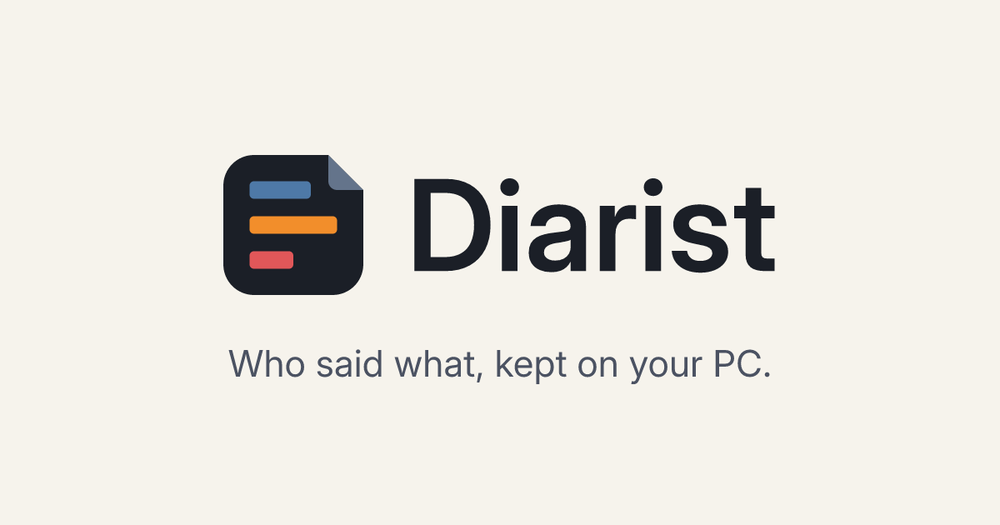
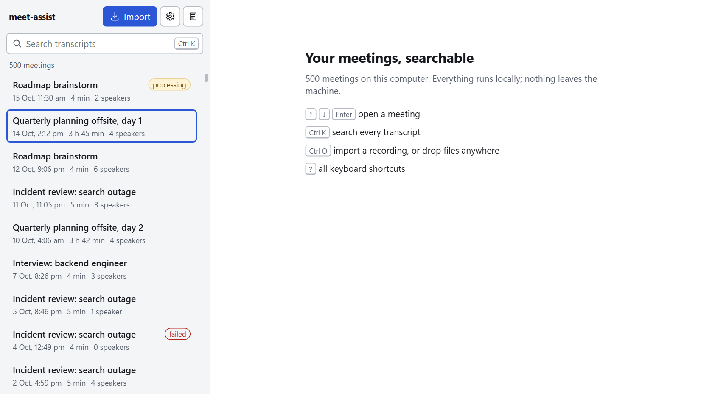
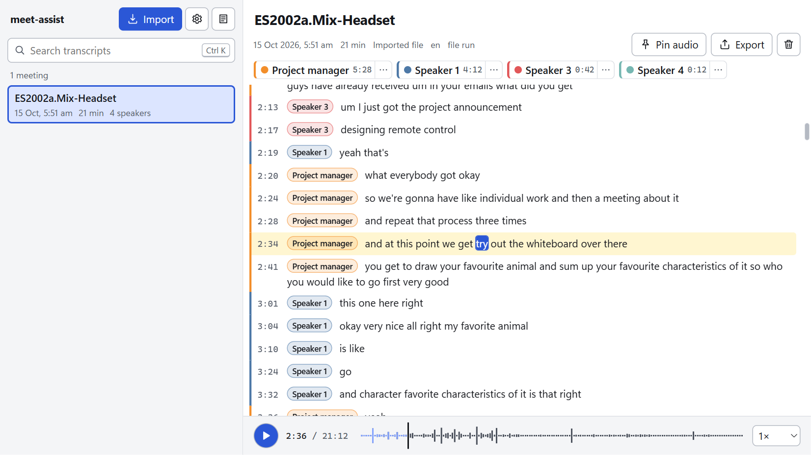
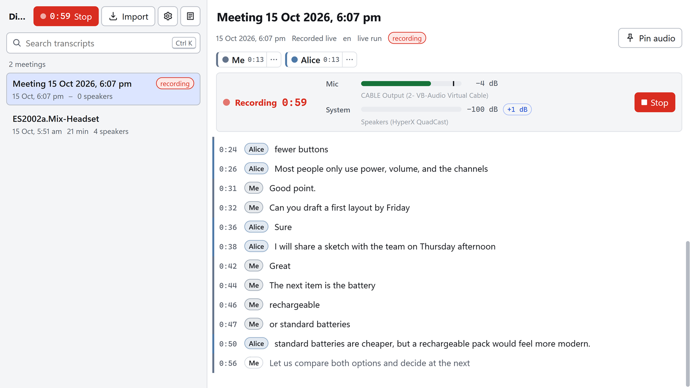
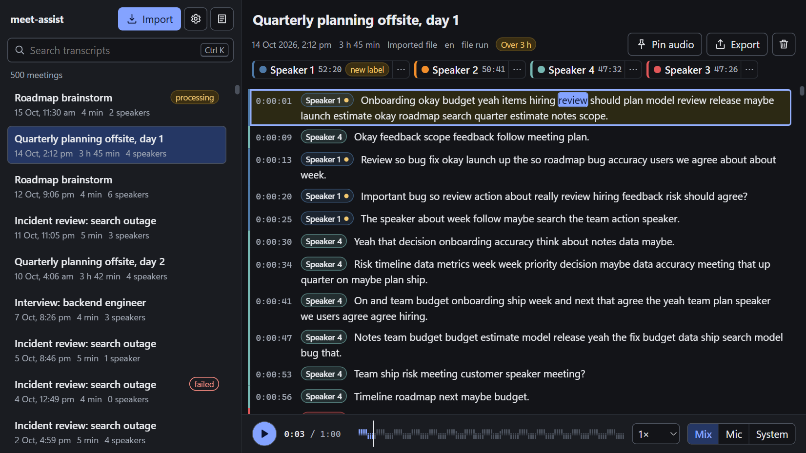

# Diarist

A meeting transcriber for Windows that runs entirely on your own PC. It records
your microphone and the sound your computer plays (Teams, Zoom, Meet, a
browser), or imports an audio or video file, and turns it into a transcript
where every line says who spoke. Transcripts live in a local, searchable
database. Nothing is uploaded: there is no account, no cloud and no telemetry.

The speech and speaker models are NVIDIA's open Nemotron models, run by
NVIDIA's NeMo-Speech.cpp runtime on your GPU. No Python, PyTorch or CUDA
toolkit is needed; the GPU driver is the only prerequisite.

| Library and search | A meeting with its speakers |
|---|---|
|  |  |
| **Recording, with live text** | **Dark theme** |
|  |  |

## What it does

- **Imports** recordings (m4a, mp3, wav, flac, ogg, mp4, mkv and more): about
  27 times faster than real time on an RTX 3080, so an hour takes two to three
  minutes.
- **Records live**: your microphone is "me", the system audio is split into
  the other speakers (up to 8). Text appears within about a second; when you
  stop, the recording is processed again for the final transcript.
- **Speakers**: rename "Speaker 2" to "Alice" once and the name sticks, merge
  labels, recolour, fix a line that went to the wrong person.
- **Search** every transcript at once (accent-insensitive, any language).
- **Export** Markdown, plain text, JSON, SRT or VTT.
- **Keyboard first**: R records, Ctrl+K searches, Ctrl+Alt+R records from any
  app, `?` lists every shortcut.

## Quick start

1. Download `Diarist_0.1.0-beta.1_x64-setup.exe` from the
   [releases page](https://github.com/ebt55/diarist/releases) and run
   it. It installs for your user only (no administrator rights) into
   `%LOCALAPPDATA%\Diarist`.
2. The first start shows a setup screen: it checks your GPU, driver and free
   space, then **Install engine (98 MB)** and **Install recommended models
   (770 MB)**. Every file is checked against its published SHA-256.
3. Press **Ctrl+O** to import a recording, or **R** to record a meeting.

Using a coding agent (Claude Code, Codex or similar)? Point it at
[docs/SETUP-WITH-AN-AGENT.md](docs/SETUP-WITH-AN-AGENT.md): it checks your PC,
picks the package and models, installs and verifies.

You can skip the setup ("Set up later"): Import and Record tell you exactly
what is missing when you use them, with a one-click fix. If a download does
not work on your network, every item shows its address, hash and folder, so
you can fetch it with a browser and drop it in. Details, firewalls, offline
machines and uninstalling: [docs/INSTALL.md](docs/INSTALL.md).

The installer is not code-signed yet, so Windows SmartScreen asks before it
runs ("More info", then "Run anyway"). The NVIDIA runtime it downloads is not
signed either; Windows Smart App Control, when it is on, may block it.

## Choosing your package and models

From [docs/04-model-guide.md](docs/04-model-guide.md). Numbers marked
*measured* were taken on an RTX 3080 10 GB; the rest are estimates and say so.

### What gets downloaded

| Component | What it does | Size | Licence |
|---|---|---|---|
| NeMo-Speech.cpp 0.2.0 (NVIDIA) | The inference runtime | 98 MB zip, 134 MB extracted (CUDA build) | Apache-2.0 |
| Nemotron 3 Diarization, q8_0 | Who spoke when, up to 8 speakers | 102 MB | OpenMDW-1.1 |
| Nemotron Speech Streaming EN 0.6B, q8_0 | Speech to text, English (default) | 668 MB | NVIDIA Open Model License |
| Nemotron 3.5 ASR Streaming 0.6B, q8_0 | Speech to text, 40+ languages (optional) | 742 MB | OpenMDW-1.1 |
| Parakeet TDT 0.6B v3, q8_0 | Experimental only (see below) | 681 MB | CC-BY-4.0 |

The default download (engine, diarizer, EN model) is about 870 MB; with
every optional model, 2.3 GB.

### Which runtime package for which PC

The setup screen detects your GPU and preselects the package; you can change it.

| Your GPU | Package | Status |
|---|---|---|
| NVIDIA with a driver new enough for CUDA 13 (R580 or newer is the estimate; 610.88 *measured* working) | CUDA | *Measured* on an RTX 3080 10 GB; kernels for Turing, Ampere, Ada and Blackwell |
| AMD or Intel, or an older NVIDIA driver | Vulkan (19 MB) | Shipped by NVIDIA; untested by us. Expected to work for files; live untested |
| No usable GPU | CPU (6 MB) | Shipped by NVIDIA; untested by us. Much slower than real time |

### How much GPU memory

*Measured* on the RTX 3080, not counting the desktop's own use (about 1.5 GB):

| Scenario | VRAM |
|---|---|
| Live recording, two channels, Nemotron 3.5 and the diarizer | 1.05 GB idle, 1.26 GB with two sessions, spikes of 0.5 to 0.6 GB per session; budget 2 GB (the EN model sits at 1.18 GB) |
| File transcription, Nemotron 3.5 | 1.82 GB peak (77-minute file) |
| File transcription, EN model | 2.6 GB peak |
| Experimental Parakeet | 4.9 GB peak |
| Live recording plus a file job | never at the same time: file jobs wait until recording stops |

Estimated tiers (the app reads free VRAM before it starts, and the live
engine unloads after 10 idle minutes):

| Card | What works |
|---|---|
| 4 GB | File mode with Nemotron 3.5 (turn on low-VRAM mode); live is borderline next to the desktop's own use |
| 6 GB | Live and file mode comfortably; Parakeet only with nothing else on the GPU |
| 8 GB and up | Everything |

### Which speech model

- **English meetings: the EN model** (default). It keeps more of what was
  said: cpWER 5.1 to 10.3 on four English Zoom meetings against 5.4 to 12.0
  for Nemotron 3.5, and 19.8 against 23.0 on the AMI meeting (*measured*).
  Speaker attribution is identical.
- **Other or mixed languages, or a 4 GB card: Nemotron 3.5.** 40+ languages
  with automatic detection, 30 percent less VRAM. It drops about 40 percent of
  filler words ("um", "uh").
- **Parakeet TDT v3 is experimental and off by default.** It punctuates well
  and is about 0.6 WER points better, but it silently skipped a 46-second span
  of a 77-minute recording (*measured*), and no chunk size avoids it. Use it
  only for short clips you check yourself.

Neither Nemotron model punctuates much; lines are split at pauses and speaker
changes instead. On clean meeting audio expect about one word in 15 to 20 to
be wrong or missing; on far-field room recordings about one in 9.

### Speakers: limits worth knowing

- Speaker diarization is Nemotron 3 Diarization, the best system on the only
  independent cross-system benchmark (DER 14.7 against 19 to 31 for the
  alternatives). On our own Zoom meetings 0.2 to 0.6 percent of words went to
  the wrong speaker, 7 to 9 percent within a second of a speaker change
  (*measured*).
- **At most 8 speakers per recording.** A ninth person is merged into an
  existing label; split very long multi-meeting recordings.
- Speaker labels in the live view are provisional; the processing after Stop
  produces the stored transcript, and names you gave during the meeting carry
  over.
- Heavy overlap, far-field microphones and noisy rooms degrade the result.

### Other requirements

- Windows 10 (1803 or newer) or Windows 11, 64-bit. WebView2 is preinstalled
  on these; the installer fetches it otherwise.
- About 1.6 GB of disk for the engine and the default models; recordings use
  about 90 MB per hour (lossless FLAC), kept 30 days by default (transcripts
  are kept forever).
- RAM: the engine uses about 300 MB (*measured*); 8 GB in total is comfortable.

## You own the folders

Like ComfyUI, models and runtimes are plain files in plain folders under the
data folder (`%LOCALAPPDATA%\app.diarist.desktop` unless you move it in
Settings):

- Drop any GGUF the runtime supports anywhere under `models\` and press
  Refresh. The app reads its header to know what it is. Settings, Models also
  has **Add from URL** and **Add from file**.
- Drop a newer runtime (the zip or the extracted folder) into `engine\`, or use
  **Check for newer runtime** in Settings, which lists NVIDIA's releases.
- Diagnostics has a **Why isn't it working?** checklist with a fix per row, and
  **Copy diagnostics** for a bug report.

## Privacy

Everything stays on your computer: audio, transcripts, names, settings. The
app makes network requests only when you ask for a download (the runtime from
GitHub, the models from Hugging Face), when you press **Check for newer
runtime** (the GitHub API), or when you press **Check for updates**. It never
checks anything by itself and sends nothing about you. See
[PRIVACY.md](PRIVACY.md).

## Status

Version 0.1.0-beta.1, the first public release (a beta pre-release): file
import and live recording work
end to end on the development machine (Windows 11, RTX 3080). The Vulkan and
CPU runtime packages and machines other than the author's are untested. Next
on the roadmap: punctuation restoration, better speaker-change handling, and
recognising the same person across meetings
([docs/plans/00-roadmap.md](docs/plans/00-roadmap.md)). Changes:
[CHANGELOG.md](CHANGELOG.md).

## Building from source

Rust, bun and the VS Build Tools: see [docs/DEV.md](docs/DEV.md) and
[CONTRIBUTING.md](CONTRIBUTING.md). Design: [docs/01-architecture.md](docs/01-architecture.md).

## Licence

MIT for the code in this repository ([LICENSE](LICENSE)). The runtime
(Apache-2.0) and the models (OpenMDW-1.1, NVIDIA Open Model License,
CC-BY-4.0) are not part of the installer; you download them at first run under
their own licences. The logo and wordmark in `branding/` are CC-BY-4.0
([branding/README.md](branding/README.md)). Third-party notices:
[LICENSES.md](LICENSES.md).
